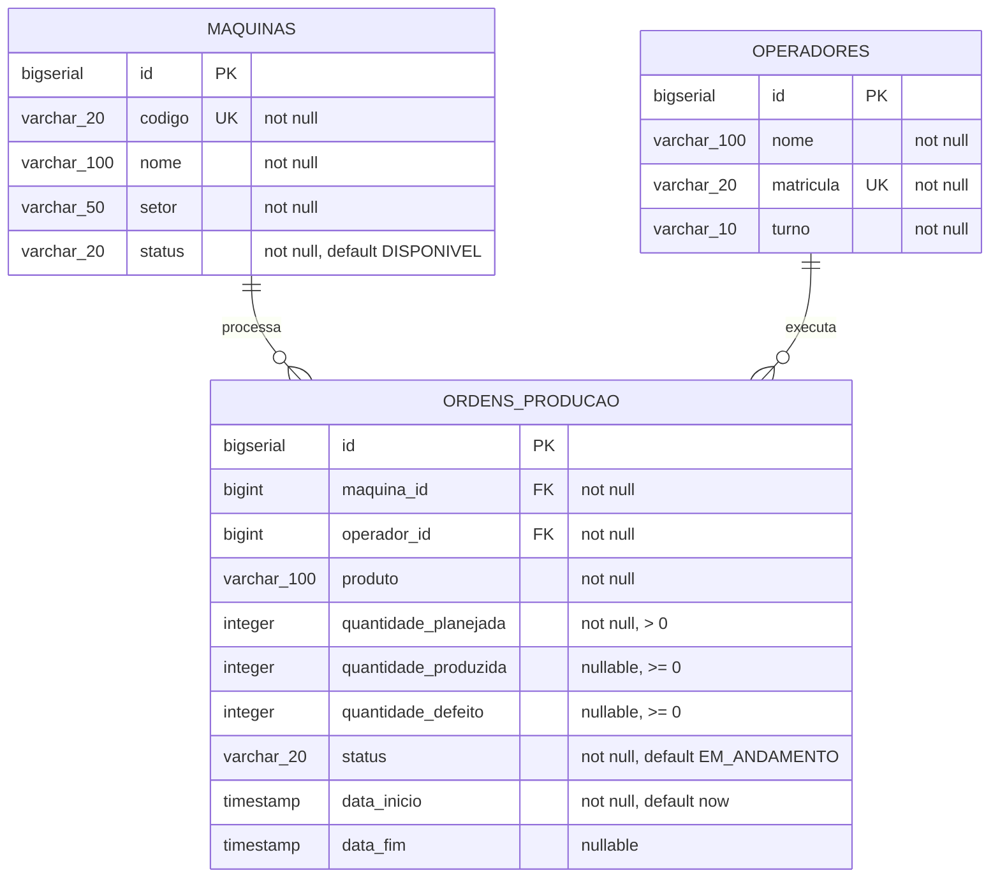

# Modelo de Domínio — Indústria e Manufatura

Documentação das entidades, atributos, tipos, relacionamentos e estrutura do banco de dados relacional (PostgreSQL).

---

## 1. Visão Geral

O sistema atende uma fábrica integrando controle de chão de fábrica, qualidade e manutenção preventiva:
* **Máquina:** Equipamento onde as peças são produzidas. Possui controle de ciclo de vida (`DISPONIVEL`, `EM_PRODUCAO`, `EM_MANUTENCAO`).
* **Operador:** Funcionário responsável pela operação no turno de trabalho (`MANHA`, `TARDE`, `NOITE`).
* **Ordem de Produção:** Registro do lote planejado e executado por um operador em uma máquina. Controla quantidades produzidas, peças com defeito e o índice de qualidade (regras R1, R2 e R3).

---

## 2. Diagrama Entidade-Relacionamento (ERD)

---

## 3. Detalhamento das Entidades

### 3.1. Máquina (`Maquina` / Tabela: `maquinas`)

Representa os equipamentos disponíveis no parque fabril.

| Campo | Coluna no Banco | Tipo Java | Tipo SQL | Constraints / Regras |
|---|---|---|---|---|
| `id` | `id` | `Long` | `BIGSERIAL` | Chave Primária (PK) |
| `codigo` | `codigo` | `String` | `VARCHAR(20)` | `NOT NULL`, `UNIQUE` (ex: "TOR-01") |
| `nome` | `nome` | `String` | `VARCHAR(100)` | `NOT NULL` (ex: "Torno CNC") |
| `setor` | `setor` | `String` | `VARCHAR(50)` | `NOT NULL` (ex: "Usinagem") |
| `status` | `status` | `StatusMaquina` | `VARCHAR(20)` | `NOT NULL`, `DEFAULT 'DISPONIVEL'` |

* **Valores possíveis para status (`StatusMaquina`):**
  * `DISPONIVEL`: Pronta para receber nova ordem de produção.
  * `EM_PRODUCAO`: Vinculada a uma ordem de produção em andamento.
  * `EM_MANUTENCAO`: Bloqueada devido a índice de defeitos elevado (> 10%), liberável via rota de liberação.

---

### 3.2. Operador (`Operador` / Tabela: `operadores`)

Representa o operador alocado para as operações no chão de fábrica.

| Campo | Coluna no Banco | Tipo Java | Tipo SQL | Constraints / Regras |
|---|---|---|---|---|
| `id` | `id` | `Long` | `BIGSERIAL` | Chave Primária (PK) |
| `nome` | `nome` | `String` | `VARCHAR(100)` | `NOT NULL` |
| `matricula` | `matricula` | `String` | `VARCHAR(20)` | `NOT NULL`, `UNIQUE` (ex: "OP-001") |
| `turno` | `turno` | `TurnoOperador` | `VARCHAR(10)` | `NOT NULL`, `CHECK (turno IN ('MANHA', 'TARDE', 'NOITE'))` |

* **Valores possíveis para turno (`TurnoOperador`):**
  * `MANHA`
  * `TARDE`
  * `NOITE`

---

### 3.3. Ordem de Produção (`OrdemProducao` / Tabela: `ordens_producao`)

Representa o lote fabril. Une máquina, operador, planejamento e resultado de qualidade.

| Campo | Coluna no Banco | Tipo Java | Tipo SQL | Constraints / Regras |
|---|---|---|---|---|
| `id` | `id` | `Long` | `BIGSERIAL` | Chave Primária (PK) |
| `maquina` | `maquina_id` | `Maquina` | `BIGINT` | `NOT NULL`, `REFERENCES maquinas(id)` |
| `operador` | `operador_id` | `Operador` | `BIGINT` | `NOT NULL`, `REFERENCES operadores(id)` |
| `produto` | `produto` | `String` | `VARCHAR(100)` | `NOT NULL` |
| `quantidadePlanejada` | `quantidade_planejada` | `Integer` | `INTEGER` | `NOT NULL`, `CHECK (quantidade_planejada > 0)` |
| `quantidadeProduzida` | `quantidade_produzida` | `Integer` | `INTEGER` | `CHECK (quantidade_produzida >= 0)`, preenchido no fechamento |
| `quantidadeDefeito` | `quantidade_defeito` | `Integer` | `INTEGER` | `CHECK (quantidade_defeito >= 0)`, preenchido no fechamento |
| `status` | `status` | `StatusOrdemProducao`| `VARCHAR(20)` | `NOT NULL`, `DEFAULT 'EM_ANDAMENTO'`, `CHECK (status IN ('EM_ANDAMENTO', 'APROVADA', 'REPROVADA'))` |
| `dataInicio` | `data_inicio` | `LocalDateTime` | `TIMESTAMP` | `NOT NULL`, `DEFAULT CURRENT_TIMESTAMP` |
| `dataFim` | `data_fim` | `LocalDateTime` | `TIMESTAMP` | Preenchido no fechamento |

* **Restrição adicional no banco:** `CHECK (quantidade_defeito <= quantidade_produzida)`.
* **Valores possíveis para status (`StatusOrdemProducao`):**
  * `EM_ANDAMENTO`: Lote em produção.
  * `APROVADA`: Lote finalizado com índice de defeitos `<= 10%`.
  * `REPROVADA`: Lote finalizado com defeitos `> 10%`.

---

## 4. Relacionamentos

* **Máquina 1 : N Ordens de Produção:** Uma máquina pode participar do histórico de várias ordens de produção ao longo do tempo, mas só pode estar ativa em uma ordem com status `EM_ANDAMENTO` por vez (garantido pela regra de negócio R1).
* **Operador 1 : N Ordens de Produção:** Um operador pode executar várias ordens no seu histórico, mas apenas uma pode estar com status `EM_ANDAMENTO` simultaneamente (garantido pela regra de negócio R2).

---

## 5. Migrations (Flyway)

O versionamento do banco de dados é mantido via Flyway na pasta `src/main/resources/db/migration`:

1. **`V1__criar_maquinas.sql`**:
   * Criação da tabela `maquinas` e inserção dos dados iniciais de teste (`TOR-01`, `FRE-01`, `PRE-01`).
2. **`V2__criar_operadores.sql`**:
   * Criação da tabela `operadores` e inserção dos operadores iniciais (`Carlos Souza`, `Ana Lima`, `João Pereira`).
3. **`V3__criar_ordens_producao.sql`**:
   * Criação da tabela `ordens_producao` com chaves estrangeiras, restrições numéricas e inserção de ordens de exemplo demonstrando as regras R1, R2 e R3.
